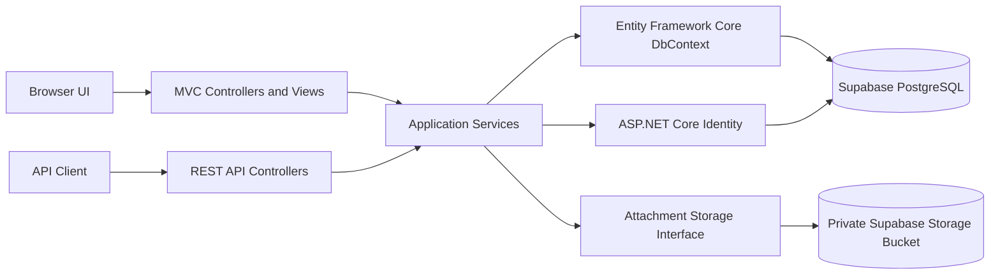

# DeskFlow architecture and development roadmap

## Project overview

DeskFlow manages IT support requests from the moment an end user reports a problem through assignment, investigation, communication, resolution, and closure. It is a portfolio application designed to demonstrate a realistic support workflow with role-based access, ticket history, private attachments, service targets, reporting, and a REST API.

The selected stack is ASP.NET Core MVC, C#, .NET 10 LTS, Entity Framework Core, Npgsql, PostgreSQL, and Supabase Storage. The interface uses Bootstrap 5 and a quieter, practical visual direction: a compact role-based menu, clear ticket queues, restrained status colors, and helpful empty states.

## Architecture choice

DeskFlow will start as a **modular monolith**. It is one deployable ASP.NET Core application with clear boundaries between web requests, business rules, data access, and integrations. This keeps the code understandable while leaving room to grow.



Controllers handle HTTP concerns and authorization boundaries. Services enforce workflows such as valid status changes, assignment, SLA calculations, notifications, and comment visibility. EF Core provides persistence. We will add focused repositories only if a query or persistence boundary benefits from one; a generic repository over EF Core would add indirection without helping this project.

## Proposed solution structure

```text
DeskFlow/
├── .gitignore
├── DeskFlow.sln
├── dotnet-tools.json
├── global.json
├── architecture-and-roadmap.md
├── database-erd.md
├── README.md
├── src/
│   └── DeskFlow.Web/
│       ├── Areas/
│       │   ├── Admin/
│       │   ├── Manager/
│       │   └── Technician/
│       ├── Controllers/
│       ├── Data/
│       │   ├── Configurations/
│       │   └── Migrations/
│       ├── DTOs/
│       ├── Interfaces/
│       ├── Models/
│       ├── Services/
│       ├── ViewModels/
│       ├── Views/
│       ├── wwwroot/
│       │   ├── css/
│       │   ├── js/
│       │   └── images/
│       ├── appsettings.json
│       └── Program.cs
└── tests/
    └── DeskFlow.Tests/
```

End users use the shared MVC area. Admin, manager, and technician screens use ASP.NET Core Areas to keep their routes and navigation organized. API controllers will be separate from MVC controllers and return DTOs so internal notes and private fields cannot leak through serialization.

## Database design decisions

- ASP.NET Core Identity owns accounts, passwords, and role membership. DeskFlow extends its user entity rather than creating a second account table.
- A user can hold multiple roles through Identity's user-role join table. Authorization is checked on the server.
- Tickets reference one requester, category, priority, and status. Their current technician assignment is represented by the latest assignment row, while `TicketAssignment` preserves the assignment history.
- Lookup records hold categories, priorities, and statuses. SLA targets reference a priority and use calendar-hour durations for the first version.
- Comments distinguish public replies from internal notes. Query services must filter internal notes before returning data to end users or API clients.
- Attachments store metadata in PostgreSQL and object keys in a private Supabase Storage bucket. The private file stays out of the public repository and is returned only after ticket access is checked.
- Ticket history captures workflow changes. Audit logs capture administrative and security-relevant actions that may not belong to one ticket.
- Ticket references are unique and generated atomically in PostgreSQL so simultaneous submissions cannot receive the same reference.
- The first version is for one organization. Organization tenancy is intentionally deferred until there is a real requirement for multiple customer organizations.

See [database-erd.md](database-erd.md) for the ER diagram and relationship explanations.

## Required software and services

1. **.NET 10 SDK** for building and running the application. SDK 10.0.403 is installed and selected by `global.json`.
2. **Visual Studio** with the ASP.NET and web development workload, or a code editor plus the .NET SDK.
3. **Git**. Git is already installed and this repository tracks GitHub's `main` branch.
4. **A Supabase account and project** for hosted PostgreSQL and private object storage. We can build most of the foundation locally before connecting it.
5. **A modern browser** for running and checking the MVC interface.
6. **The local .NET CLI tool `dotnet-ef`** for creating and applying EF Core migrations. Version 10.0.14 is pinned in `dotnet-tools.json`.

PostgreSQL command-line tools or a database GUI are optional; Supabase's dashboard is enough for initial project setup.

## Initial Supabase configuration requirements

To apply the migration, create a Supabase project and keep the following values available locally:

- Project reference and region.
- Database password.
- PostgreSQL connection string copied from **Connect** in the Supabase dashboard. Do not construct the pooler hostname or username by hand.
- Supabase project URL and a server-side storage credential when we reach attachment work. These are not needed in the browser or GitHub.

For local development, choose the database connection mode based on the network. A direct connection is intended for a persistent backend when IPv6 (or the IPv4 add-on) is available. Supabase's shared session pooler is the alternative for IPv4-only networks. Database migrations are best run on a direct connection where reachable. Require SSL (`sslmode=require` at minimum).

Store secrets with ASP.NET Core User Secrets during development and environment variables in deployment. Never put a password, database URL, Supabase service-role key, or storage secret in `appsettings.json`, JavaScript, or Git. Store ticket attachments in a private bucket; a public bucket would allow anyone with a file URL to retrieve its contents.

For this .NET project, convert the host, port, database, username, and password shown by Supabase into Npgsql's `keyword=value;` format. Then run this template from the repository root after replacing each placeholder locally:

```powershell
dotnet user-secrets set "ConnectionStrings:DefaultConnection" "Host=<host>;Port=5432;Database=postgres;Username=<username>;Password=<database-password>;SSL Mode=Require" --project src/DeskFlow.Web
dotnet tool run dotnet-ef database update --project src/DeskFlow.Web --startup-project src/DeskFlow.Web
```

Do not send the completed connection string in chat or commit it. `ApplicationDbContextFactory` has a clearly labeled migration-only fallback so EF Core can generate the initial migration before the real database exists; that fallback cannot connect to a database. In Development, the MVC shell runs without Identity when no connection string is set. Production startup fails fast if the connection string is missing.

The solution builds, the first migration has been generated, and `dotnet-ef database update` reports that Supabase is already up to date. The foundation, account basics, and requester ticket flow are implemented. Staff queue and assignment work is tracked in [GitHub issue #1](https://github.com/Malefetsane95/DeskFlow/issues/1); the implementation currently exists in the local workspace and needs a local commit and push before it appears on the repository's `main` branch.

## Development roadmap

| Phase | Scope | Completion checkpoint |
|---|---|---|
| 1. Project foundation | Create the solution, configure EF Core/Npgsql, implement the first normalized entities, and create the initial migration | App builds; migration creates the schema in a development database |
| 2. Authentication | Identity, roles, registration, login, profiles, and authorization policies | Each role can sign in and only access permitted routes |
| 3. Interface foundation | Shared layout, compact role navigation, responsive ticket lists, and role dashboards | Main screens work at desktop and mobile sizes using real database data |
| 4. Ticket workflow | Categories, priorities, ticket submission, detail pages, and status transitions | End users can submit and track tickets; invalid transitions are rejected |
| 5. Technician workflow | Assignment, reassignment, public comments, internal notes, and activity history | Assignment and communication permissions are enforced on the server |
| 6. Attachments and notifications | Private file uploads, authorized downloads, and read/unread in-app notifications | A user cannot retrieve an attachment or notification they do not own or may not view |
| 7. SLA and reporting | Calendar-hour targets, overdue tracking, operational charts, CSV/PDF export | Metrics are computed from stored ticket and event data |
| 8. REST API and quality | DTO-based API, pagination, filtering, Swagger, and xUnit coverage of business rules | API access rules match the MVC rules and key workflow rules are covered |
| 9. Deployment and portfolio | Secure configuration, deployment, README, screenshots, and demo data | A public demonstration can be run without exposing secrets or real user data |

We will complete and review each phase before moving on.
