# DeskFlow database entity relationship diagram

The diagram describes the initial, single-organization relational model. ASP.NET Core Identity supplies the account and role tables. DeskFlow adds the support workflow tables shown below.

```mermaid
erDiagram
    ASPNET_USERS ||--o| USER_PROFILES : has
    ASPNET_USERS ||--o{ ASPNET_USER_ROLES : belongs_to
    ASPNET_ROLES ||--o{ ASPNET_USER_ROLES : grants

    ASPNET_USERS ||--o{ TICKETS : requests
    TICKET_CATEGORIES ||--o{ TICKETS : classifies
    TICKET_PRIORITIES ||--o{ TICKETS : prioritizes
    TICKET_STATUSES ||--o{ TICKETS : tracks

    TICKETS ||--o{ TICKET_ASSIGNMENTS : assigned_over_time
    ASPNET_USERS ||--o{ TICKET_ASSIGNMENTS : technician
    TICKETS ||--o{ TICKET_COMMENTS : has_conversation
    ASPNET_USERS ||--o{ TICKET_COMMENTS : writes
    TICKETS ||--o{ TICKET_ATTACHMENTS : has_files
    ASPNET_USERS ||--o{ TICKET_ATTACHMENTS : uploads
    TICKETS ||--o{ TICKET_HISTORY : records_changes
    ASPNET_USERS ||--o{ TICKET_HISTORY : performs
    TICKET_PRIORITIES ||--o{ SLA_RULES : sets_targets
    TICKET_REFERENCE_COUNTERS {
        int ReferenceYear PK
        int LastNumber
    }

    ASPNET_USERS ||--o{ NOTIFICATIONS : receives
    TICKETS o|--o{ NOTIFICATIONS : relates_to
    ASPNET_USERS ||--o{ AUDIT_LOGS : performs
    TICKETS o|--o{ AUDIT_LOGS : relates_to
    TICKETS ||--o| USER_FEEDBACK : receives
    ASPNET_USERS ||--o{ USER_FEEDBACK : submits

    ASPNET_USERS {
        string Id PK
        string Email UK
        string UserName UK
        bool IsActive
    }
    ASPNET_ROLES {
        string Id PK
        string Name UK
    }
    ASPNET_USER_ROLES {
        string UserId PK,FK
        string RoleId PK,FK
    }
    USER_PROFILES {
        string UserId PK,FK
        string DisplayName
        string Department
        string Phone
    }
    TICKETS {
        bigint Id PK
        string Reference UK
        string RequesterId FK
        int CategoryId FK
        int PriorityId FK
        int StatusId FK
        string Title
        text Description
        timestamptz CreatedAt
        timestamptz FirstRespondedAt
        timestamptz ResolvedAt
        timestamptz ClosedAt
    }
    TICKET_CATEGORIES {
        int Id PK
        string Name UK
        bool IsActive
    }
    TICKET_PRIORITIES {
        int Id PK
        string Code UK
        string Name UK
        int SortOrder
    }
    TICKET_STATUSES {
        int Id PK
        string Code UK
        string Name UK
    }
    TICKET_ASSIGNMENTS {
        bigint Id PK
        bigint TicketId FK
        string TechnicianId FK
        string AssignedById FK
        timestamptz AssignedAt
        timestamptz UnassignedAt
    }
    TICKET_COMMENTS {
        bigint Id PK
        bigint TicketId FK
        string AuthorId FK
        string Visibility
        text Body
        timestamptz CreatedAt
    }
    TICKET_ATTACHMENTS {
        bigint Id PK
        bigint TicketId FK
        string UploadedById FK
        string ObjectKey UK
        string OriginalFileName
        string ContentType
        bigint SizeBytes
        timestamptz CreatedAt
    }
    TICKET_HISTORY {
        bigint Id PK
        bigint TicketId FK
        string ActorId FK
        string EventType
        string PreviousValue
        string NewValue
        timestamptz OccurredAt
    }
    SLA_RULES {
        int Id PK
        int PriorityId FK
        int ResponseTargetMinutes
        int ResolutionTargetMinutes
        bool IsActive
    }
    NOTIFICATIONS {
        bigint Id PK
        string RecipientId FK
        bigint TicketId FK
        string Type
        string Message
        timestamptz CreatedAt
        timestamptz ReadAt
    }
    AUDIT_LOGS {
        bigint Id PK
        string ActorId FK
        bigint TicketId FK
        string ActionType
        jsonb PreviousValue
        jsonb NewValue
        timestamptz OccurredAt
    }
    USER_FEEDBACK {
        bigint Id PK
        bigint TicketId FK,UK
        string UserId FK
        int Rating
        text Comment
        timestamptz SubmittedAt
    }
```

## Major relationships

- **Identity users, roles, and profiles:** users and roles have a many-to-many relationship through `AspNetUserRoles`. Each account may have one optional `UserProfile` row for display and department details. Identity continues to own authentication data.
- **Users and tickets:** each ticket has exactly one requester. A user can request many tickets. A ticket keeps its creator for its lifetime.
- **Categories, priorities, and statuses:** each ticket references one row from each lookup table. A category or priority can be deactivated without deleting old ticket history. Status values are controlled by application workflow rules.
- **Assignments:** a ticket can have many assignment records over time. Each assignment identifies a technician and the manager or administrator who assigned it. The currently active assignment has `UnassignedAt = null`; the database/application must prevent more than one active assignment for a ticket.
- **Comments and attachments:** each ticket has many comments and attachments. Both record their author/uploader. Internal notes use an explicit visibility value and must be filtered in the service/query layer before MVC views or API DTOs are created.
- **Ticket history and audit logs:** `TicketHistory` is the ticket-specific timeline. `AuditLogs` records platform-wide administration and security-relevant actions, optionally linked to a ticket. They answer different questions and are not duplicate copies of every event.
- **SLA rules:** one active SLA rule per priority supplies response and resolution targets in minutes. They are elapsed calendar hours in the first version; business hours and holidays can be added later without changing ticket timestamps.
- **Notifications:** each notification has one recipient and may relate to a ticket. A nullable `ReadAt` marks unread notifications without a separate read flag.
- **Feedback:** each ticket can have zero or one feedback record. A unique constraint on `TicketId` enforces one response per ticket.

## PostgreSQL constraints and indexes to implement

- Unique index on `Tickets.Reference` and `TicketAttachments.ObjectKey`.
- Unique indexes on category name, priority code/name, status code/name, and one SLA rule per priority (or per priority and category if that feature is added later).
- Check constraints for positive SLA durations, non-negative attachment size, and feedback rating range.
- Composite index on `(RequesterId, CreatedAt)` and `(StatusId, PriorityId, CreatedAt)` to support common ticket lists and dashboards.
- Index `TicketAssignments` by `(TechnicianId, UnassignedAt)` and `(TicketId, AssignedAt)`.
- Index comments/history by `(TicketId, CreatedAt)` / `(TicketId, OccurredAt)` and notifications by `(RecipientId, ReadAt, CreatedAt)`.
- Foreign keys use restrictive deletes for tickets and users with historical records. Reference data should be deactivated rather than removed when already used.

## Ticket reference generation

References follow `DF-YYYY-NNNN`, for example `DF-2026-0001`. The year and sequence must be allocated atomically in PostgreSQL (for example, a yearly counter row updated in a transaction) and backed by a unique constraint. An in-memory counter would fail when two users submit tickets at the same time or the application restarts.

`TicketReferenceCounters` contains one row per year. A transaction increments `LastNumber` and uses the returned value to build the reference before inserting the ticket. The unique constraint on `Tickets.Reference` remains the final safeguard.
